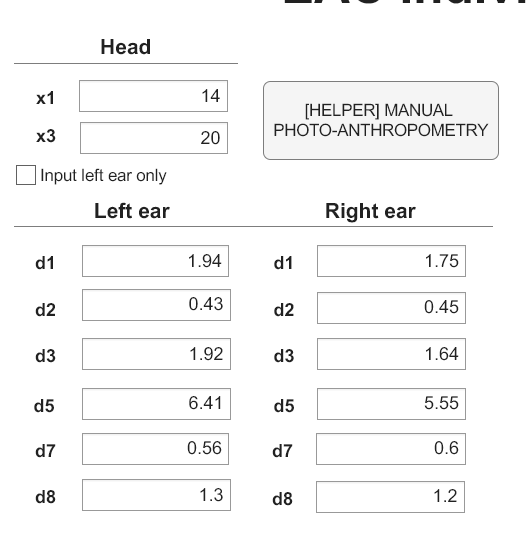

# 27_95_142.wav 生成参数

`src/assets/hrir_wav/27_95_142.wav` 是 2026 年 4 月用 **EAC Individualized HRTF
Synthesis** 生成的个人 HRIR。这个目录保存当时的精确输入、来源截图和校验信息，
目的是以后重新生成或调参时不需要重新测量，也不会再与 1 月的旧参数混淆。

> 2026-04-04 的截图和 `LR20260404_48000Hz.wav` 是同一组输入；2026-04-06 的
> `27_95_142.wav` 沿用同一组值。两者的中心声道在 500–16 kHz 上 RMS 仅
> 0.008–0.011 dB、相关 1.00000。

## 精确输入

| 参数 | 左耳 | 右耳 |
|---|---:|---:|
| `x1`（头宽，cm） | **14.00** | — |
| `x3`（头深，cm） | **20.00** | — |
| `d1` | **1.94** | **1.75** |
| `d2` | **0.43** | **0.45** |
| `d3` | **1.92** | **1.64** |
| `d5` | **6.41** | **5.55** |
| `d7` | **0.56** | **0.60** |
| `d8` | **1.30** | **1.20** |

- `Input left ear only`：**未勾选**（左右耳独立）
- 单位：**cm**
- 采样率：**48000 Hz**
- 导出：**HeSuVi 14ch**（同时可导出 SOFA）
- 目标角度：**27° / 95° / 142°**（FreeSurround 匹配角；右侧为 333° / 265° / 218°）

同目录的 `parameters.json` 是同一份数据的机器可读版本。

## 来源截图



- 文件：`QQ20260404-014049.png`（531×547，8-bit RGBA PNG，28,367 bytes）
- 创建/修改时间：**2026-04-04 01:40:53 +0800**（文件名时间 01:40:49）
- 来源：Windows 用户目录的 `Pictures`；本目录保存的是原图副本，SHA-256 与原件一致
- 截图只裁到 Head / Left ear / Right ear 面板；采样率、导出格式和角度不在这张
  裁剪图里，由同批输出和生成代码确认

## 时间线

| 时间 | 事件 |
|---|---|
| 2026-04-04 01:40:53 | 参数截图 |
| 2026-04-04 01:41:11.560 | `LR20260404_48000Hz.wav` 生成（约 18 秒后；默认 30/90/135 角度） |
| 2026-04-06 06:02:16.340 | `27_95_142.wav` 生成（沿用同一组输入；27/95/142 角度） |

`LR20260404_48000Hz.wav` 也保存在本目录，作为同一组输入的独立证据。

## 生成设置

生成器：EAC Individualized HRTF Synthesis 的 `model_engine.m`（用户修改版）。

被强制指定的自定义网格：

```matlab
custom_pos = [
    0,   0, 1;
    27,  0, 1;
    95,  0, 1;
    142, 0, 1;
    333, 0, 1;
    265, 0, 1;
    218, 0, 1
];
```

HeSuVi 角度（左/右对称由源码处理）：

```matlab
FR = 27°;  SR = 95°;  RR = 142°;
FF = 0°;
FL = 27°;  SL = 95°;  RL = 142°;
```

关键参数：

- 仿真采样率：44100 Hz；DTF 长度 100（正频率），相位重建后 200 点 IR
- 输出采样率：48000 Hz（`sofaResample`）
- 输出：HeSuVi 14ch，32-bit float，218 帧，峰值 0.975
- HeSuVi 通道重排：`[1,2,3,4,5,6,7,10,9,12,11,14,13,8]`

原始 `model_engine.m`、`net_treinada_CIPIC_ARI_ITA_3D3A.mat` 和
`target_pca_CIPIC_ARI_ITA_3D3A.mat` 位于外部 9919 盘的 Individualized
HRTF Synthesis 工程中，不在本仓库；文件哈希见下节，可用于确认使用的是同一版
模型和脚本。

## 验证

- 用 `27_95_142` + `LR20260404` 的精确方向（0/95/265 与 30/90/135）在
  500–16 kHz 做独立反演：`x1=13.79`、`x3=19.68`，左右耳 d 值与截图差
  **≤0.32 cm**；反演拟合 RMS 0.37/0.39 dB。
- 用截图值做 Python 复现：0/95/265 六个通道逐样本一致（相关 1.00000，频谱
  0.003–0.007 dB）；27/142/333/218 四个插值方向相关 0.984–0.996，频谱差
  0.19–0.38 dB。
- 四个插值方向的剩余差异来自 MATLAB 专有的 `interpolateHRTF`（Audio
  Toolbox）；Octave/Python 的“最近邻 + 1 样本对齐”只能近似，不能 bit-exact。
  0/95/265 不受影响。

## 不要与 1 月参数混用

2026-01-09 的 `HRTF1.wav_48000Hz.wav` 是另一组测量：

| 参数 | 1 月 HRTF1 |
|---|---|
| `x1` | 14.5 |
| `x3` | 19.5 |
| `Input left ear only` | 勾选（左右相同） |
| `d1..d8` | 2.0 / 0.4 / 1.5 / 5.7 / 0.45 / 1.3 |

1 月与 4 月的中心声道相差 0.72/0.88 dB。**27_95_142 和 LR 请使用本文档的 4 月
参数，不要填 1 月截图的值。**

## 重新生成

1. 打开 EAC Individualized HRTF App，按上表填入 4 月参数；单位 cm；
   `Input left ear only` 不勾选；采样率 48000 Hz。
2. 使用修改版 `model_engine.m` 的 `custom_pos` 和 HeSuVi 角度（27/95/142），
   导出 HeSuVi 14ch（或 SOFA）。
3. 预期输出为 218 帧、14 通道、32-bit float、峰值 0.975；帧数是
   200 点 @44.1k 经 48k 重采样后的结果。
4. 如果不是 MATLAB 环境，0/95/265 可以精确复现；27/142/333/218 的插值会
   有约 0.2–0.4 dB 的差异。

## 文件与 SHA-256

| 文件 | SHA-256 |
|---|---|
| `QQ20260404-014049.png`（本目录副本） | `96f339a529e27cc90117baddb9ac3cbc7b03b3dfab918d820b8025025f68fd94` |
| `LR20260404_48000Hz.wav`（本目录副本） | `def846cccc508c9971a3fde182bcbb1fac9c03fcf68e004b828bf0e08d1e1bde` |
| `src/assets/hrir_wav/27_95_142.wav` | `73706b5e521bcbd5addbb2430753b43d0c9d7fc3d30e92e8e0d3d20b3205b438` |
| `model_engine.m`（生成器） | `26119f37bd0cb88ee26ec67880c941c450c149bd0713f4d4e287861be187de35` |
| `net_treinada_CIPIC_ARI_ITA_3D3A.mat` | `8b1cf77efaefee51e9b16bfb72ca3a0e58d8d9fbad2592054072c188508f9d29` |
| `target_pca_CIPIC_ARI_ITA_3D3A.mat` | `032fe4a89a92a4e8a062439762e1e31ad26f37ed2a816be96f2777190a3eabd3` |

相关文件：

- `parameters.json` — 机器可读参数
- `QQ20260404-014049.png` — 来源截图
- `LR20260404_48000Hz.wav` — 同组输入的默认角度输出
- `src/assets/hrir_wav/27_95_142.wav` — 项目内置的最终 HRIR
